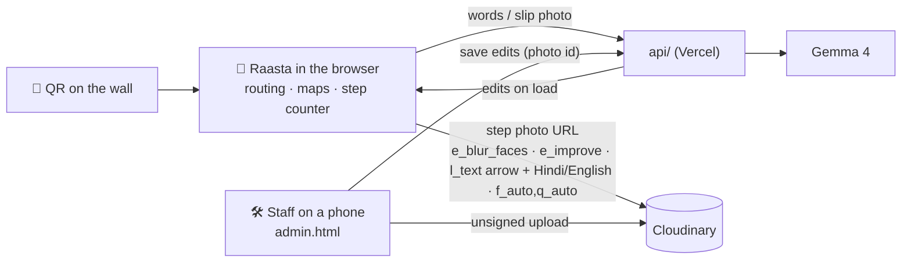

# Raasta · रास्ता: hospital mein rasta, apni bhasha mein, asli photo ke saath

> Paste this into your duplicated "Hacktober Hack Days" Notion template. Section numbers match it.
> Replace every [bracket]. Add screenshots under section 12.

## 1. Project Overview

| Field | Details |
|---|---|
| Project name | Raasta · रास्ता |
| Team name | [Team name] |
| Track / theme | Empowering Local Communities (healthcare, accessibility) |
| One-line pitch | Indoor wayfinding for Indian hospitals and public buildings: scan a QR, say where you need to go in Hindi, Hinglish or English, and follow a real photo of every turn with the arrow painted on it by Cloudinary. |
| Repository link | https://github.com/shaunmortal/raasta |
| Live demo link | https://raasta-shebuilds.vercel.app (landing) · https://raasta-shebuilds.vercel.app/app/ (app) · staff panel: https://raasta-shebuilds.vercel.app/admin.html |
| Demo video link | [YouTube / Drive link] |
| Presentation / slides | [Link] |

## 2. Team Members and Roles

| Name | Role | Responsibilities | Contact |
|---|---|---|---|
| [Name] | Team lead | Problem research, hospital visits, pitch | [handle] |
| [Name] | Developer | Routing engine, maps, Cloudinary layer | [handle] |
| [Name] | Developer | AI endpoints, admin panel, tests | [handle] |
| [Name] | Design / content | Hindi copy, photos of the real building, demo video | [handle] |

## 3. Problem Statement

**The problem:** A big Indian government hospital has 4 blocks, 4 floors and around 200 rooms. Signs are in one language, floor plans mean nothing to most visitors, and the person holding the OPD slip is often elderly, worried, or does not read English. They ask three strangers where the blood bank is, and get lost anyway.

**Who is affected:** Patients and their attendants in large hospitals (OPD visitors, people coming from villages, elderly visitors, people with low literacy, wheelchair users), and the hospital staff who answer the same question all day.

**Why it matters:** Lost time in a hospital is not an inconvenience. It means a missed test slot, a long walk for someone who should not be walking, and stress for a family already in trouble.

**Existing solutions and their gaps:**
- Google Maps stops at the hospital gate.
- Indoor-positioning systems need beacons or Wi-Fi mapping, and an app install. Most hospitals never install them.
- Printed floor plans need the visitor to read a map, and usually only in English.
- Nothing shows the visitor *what the next turn actually looks like*.

## 4. Proposed Solution

**Overview:** Raasta is a web app opened from a QR sticker on the wall. No install, no beacons, no login. The visitor says where they need to go in their own words ("mausa ko blood chahiye"), or photographs their OPD slip. The app picks the right place and shows a step-by-step route across floors, by lift or stairs, on a 2D or 3D map. At every step it shows a **real photo of that spot, with the arrow and a Hindi + English instruction painted on it by Cloudinary**, and faces in the photo blurred. The phone's step counter moves the route along as they walk and warns them if they go the wrong way.

**Unique value:**
- **A photo you can follow.** Many visitors cannot read a map. Everyone can match a photo to what is in front of them.
- **Built by the hospital's own staff in an afternoon.** Staff walk the building once with a phone and add photos from the admin panel. Cloudinary does the rest: faces blurred, light fixed, arrows and words painted, sized for 2G.
- **Language as people speak it.** Hindi, Hinglish and English, typed or spoken, with Gemma 4 understanding intent ("papa ICU mein hain" means the ICU *attendant waiting area*, not the ICU door).
- **Works when the network does not.** Routing runs in the browser; the AI only helps understand words and photos.

**Key features:**
- Real photo of every turn, with arrow + bilingual instruction painted by Cloudinary, faces blurred
- Staff photo upload from the admin panel, straight to Cloudinary
- Ask in Hindi / Hinglish / English, typed or by voice (Gemma 4)
- OPD slip photo → the right department; photo of a room sign → "you are here"
- Shortest route across floors, step-free option, "lift not working" re-route
- Step counting with an off-route warning; read-aloud in Hindi or English
- 2D, 3D and Real-3D maps of a full-size demo hospital (4 blocks, 4 floors, ~190 rooms)

**Out of scope (for now):** live indoor positioning (we use QR + step counting instead), accounts, and booking appointments.

## 5. Tech Stack and Architecture

| Layer | Technology | Why we chose it |
|---|---|---|
| Frontend | Vite + TypeScript (no framework), Three.js | Fast on budget phones; the 3D map is plain Three.js |
| Backend | Vercel functions (`api/`) | Only for AI and staff edits; routing never needs the server |
| Media | **Cloudinary** (Upload API, transformations) | Every real photo: face blur, light fix, arrow + text painted, crop, `f_auto,q_auto` |
| AI | Gemma 4 (Ollama locally, Gemini API in the cloud) | Understands Hindi / Hinglish intent and reads slips and signs; answers only with ids we check |
| Data | `site.json` per building + staff edits | Buildings are data, not code; staff edits are laid over the data on load |
| Hosting | Vercel | Static app + functions, one deploy |
| Tools | Vitest (102 tests), Prettier, tsc strict | Routing, data, UI, API and Cloudinary URL tests |

**Architecture overview:**

**Data flow:** The QR tells the app where the visitor stands. Their words go to `/api/ask`, which returns only place ids from this building; the route is computed on the phone. For each step, `paintFor()` picks the arrow and the Hindi + English line, and `stepPhoto()` builds one Cloudinary URL that blurs faces, fixes the light, paints both, crops to 16:9 and picks the format and quality for the device. Staff photos are uploaded from the admin panel straight to Cloudinary; only the public id is saved with the staff edits.

### How we use Cloudinary (and why each piece is there)

| Need | Cloudinary feature | URL piece |
|---|---|---|
| Privacy of people in a corridor | Face detection + blur | `e_blur_faces:800` |
| Dim corridors | Auto improve | `e_improve` |
| "Which way?" on the photo itself | Text overlay with an arrow glyph, rounded badge | `l_text:Arial_120_bold:←,b_rgb:2563eb,bo_22px…/r_28/fl_layer_apply,g_center` |
| Instruction in Hindi + English | Text overlay in Hind (Devanagari) with wrapping | `l_text:Hind_40_bold:बाएँ मुड़ें · Turn left,w_880,c_fit/fl_layer_apply,g_south` |
| Phone-sized, keep the subject | Smart crop | `c_fill,g_auto,w_960,h_540` |
| 2G networks | Automatic format and quality | `f_auto,q_auto` |
| Staff add photos with no server of ours | Unsigned upload preset, tags | `upload_preset=raasta`, `public_id=raasta/<site>/staff-<room>-<time>` |
| Existing photos | One-time bulk upload | `tools/cld-upload.mjs` |

## 6. Feature Tracker

| Feature | Owner | Priority | Status | Notes |
|---|---|---|---|---|
| Cloudinary step photos (blur, arrow, bilingual line) | [Name] | High | Done | `src/cld.ts`, `paintFor()` in `src/ui/scene.ts` |
| Staff photo upload in admin panel | [Name] | High | Done | Saved as `photo` in staff edits, only ids in our folder accepted |
| Ask in Hindi / Hinglish / English (Gemma 4) | [Name] | High | Done (before the hackathon) | |
| OPD slip + room sign photos | [Name] | Medium | Done (before the hackathon) | |
| Step counter + off-route warning | [Name] | Medium | Done (before the hackathon) | |
| 2D / 3D / Real-3D maps | [Name] | Medium | Done (before the hackathon) | |
| Printable QR wall signs from Cloudinary | — | Low | Not started | Future scope |

## 7. Progress Tracker

Raasta started before this hackathon as our hospital-wayfinding prototype. During Hacktober HackDays we built the Cloudinary photo layer and the staff photo upload.

| Day | Date | Focus | Status |
|---|---|---|---|
| [Day #] | [Date] | [What you did on earlier days, honestly] | [Status] |
| Submission day | 26 Oct 2026 | Cloudinary feasibility tests, step-photo painting, staff upload, real buildings, docs, deploy, video | Done |

## 8. Daily Log

**Submission day (26 Oct 2026)**
- **Goals for today:** make Cloudinary do real work for the visitor, not decoration.
- **What we completed:** tested face blur, text overlays and fonts live on Cloudinary before writing code; built the step-photo painter, the staff upload, the bulk upload tool and tests; rewrote the docs.
- **Blockers / challenges:** see section 9.
- **Learnings:** a transformation URL is a small program. Test each piece alone, then chain them.
- **Final reflections:** [Your own words]

[Add your earlier days here.]

## 9. Challenges and Solutions

| Challenge | Day faced | How we solved it | Lesson learned |
|---|---|---|---|
| Hindi text on the photo failed: "Unsupported font family Noto Sans Devanagari" | Submission day | Tested fonts with real requests; **Hind** is supported and has Devanagari and ₹ | Check font support before designing around it |
| Commas inside overlay text broke the URL | Submission day | Commas and slashes are syntax in a transformation, so `txt()` double-escapes them (`%252C`, `%252F`); a test covers it | Free text in a URL must be escaped twice |
| Unsigned uploads cannot overwrite an existing photo | Submission day | Each staff photo gets a new id (`staff-<room>-<time>`); the edit points to the newest | Design ids for the upload mode you use |
| Never trust an id from the client | Submission day | The server only accepts photo ids inside `raasta/…`; anything else is dropped | Validate at the boundary |
| App must still work without Cloudinary or network | Submission day | `stepPhoto()` falls back to the local photo when Cloudinary is not configured | Media enhancement should never be a single point of failure |

## 10. Testing and Setup Notes

**How to run the project locally:**
1. `git clone https://github.com/shaunmortal/raasta && cd raasta && npm install`
2. `cp .env.example .env`, then set `VITE_CLOUDINARY_CLOUD` (your cloud name) and `VITE_CLOUDINARY_PRESET` (an **unsigned** upload preset, e.g. `raasta`). For AI: run Ollama with `gemma4:e2b-it-qat`, or set `GEMINI_API_KEY`. For the admin panel: set `ADMIN_PASSWORD`.
3. Once: `node --env-file=.env tools/cld-upload.mjs` uploads the existing building photos to Cloudinary.
4. `npm run dev` → landing at `/`, app at `/app/`, admin at `/admin.html`.

**Testing approach:** `npm test` runs 102 Vitest tests (routing, data checks, UI smoke test, API handlers with a mocked model, Cloudinary URLs and staff-photo validation). Manual end-to-end in Chrome: staff add photos of spots in the admin panel, then a visitor's route shows them with painted arrows and blurred faces. [Add any user testing you did.]

**Known issues:**
- The demo hospital is made up; its spot photos come from staff uploads in the admin panel (for the demo, photos we took of real doors and corridors).
- The unsigned preset lets anyone who finds it upload to our demo folder. A real hospital deployment should sign uploads on the server and moderate.
- Generated photo versions are cached by Cloudinary after the first view; the very first view of a step takes a second longer.

**Test accounts / sample data:** admin password is set in your own `.env` (never committed).

## 11. Final Submission Checklist

- [ ] Project name, pitch, and team details are filled in
- [ ] Problem statement and solution are clearly explained
- [ ] Repository is public and has a clear README
- [ ] Code contains no secrets (cloud name and unsigned preset are public by design; `.env` is git-ignored)
- [ ] Live demo link works
- [ ] Demo video is recorded and the link is accessible
- [ ] Presentation / pitch deck is ready
- [ ] Daily log is updated
- [ ] Screenshots are added below
- [ ] Notion page is shared with the organizers
- [ ] Submission form is filled before 5:00 PM IST

## 12. Screenshots and Demo Media

[Paste: a step with the painted arrow on a real photo · the same photo before Cloudinary · admin photo column · Hindi question → route · 3D map]

## 13. Future Scope

- Printable QR wall signs for every room, composed by Cloudinary (QR + bilingual name + arrow), one click from admin
- Signed uploads and moderation for staff photos
- A short video clip per tricky junction (Cloudinary video, trimmed and compressed)
- More real hospitals, starting with one OPD block

## 14. Resources and References

| Resource | Link | Used for |
|---|---|---|
| Cloudinary transformation reference | https://cloudinary.com/documentation/transformation_reference | All URL parameters |
| Cloudinary text overlays | https://cloudinary.com/documentation/layers#text_overlays | Arrow and Hindi + English line |
| Cloudinary face detection effects | https://cloudinary.com/documentation/face_detection_based_transformations | `e_blur_faces` |
| Cloudinary unsigned upload | https://cloudinary.com/documentation/upload_images#unsigned_upload | Staff photo upload |
| Gemma 4 | https://ai.google.dev/gemma | Understanding words and photos |
| Three.js | https://threejs.org | 3D maps |

## 15. Acknowledgments

SheBuilds Delhi Chapter, MLH and Cloudinary. [Mentors, and anyone who helped with photos or testing.]

*Built during Hacktober HackDays (Cloudinary layer), on our earlier Raasta prototype.*
