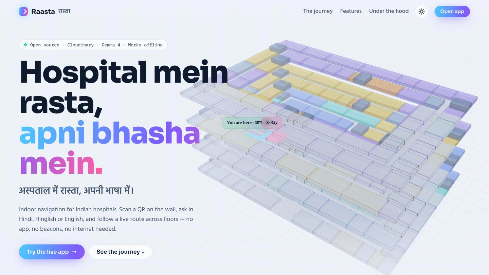
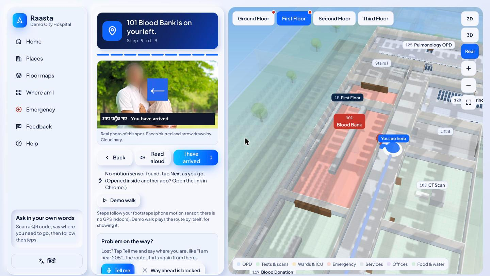
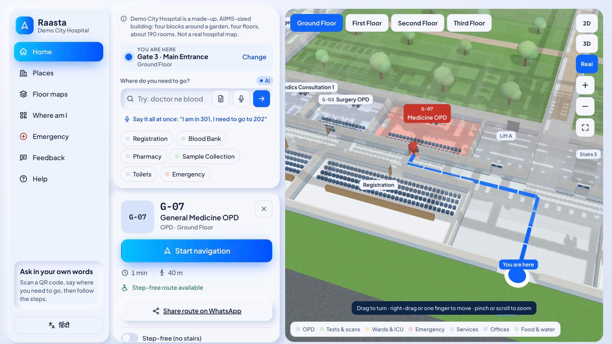
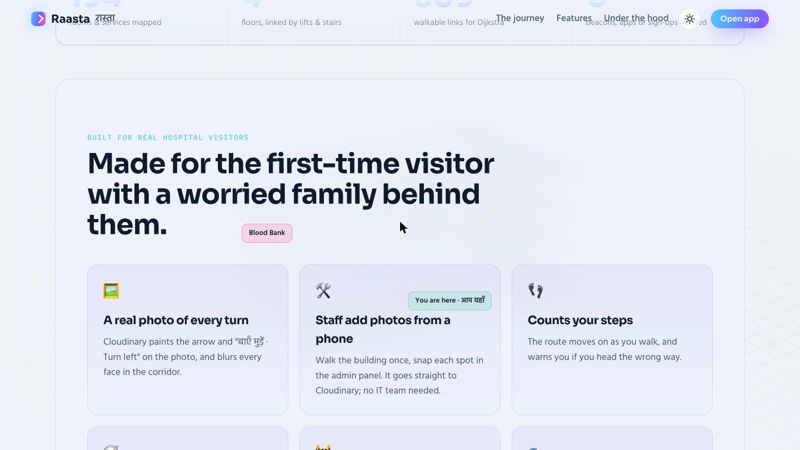
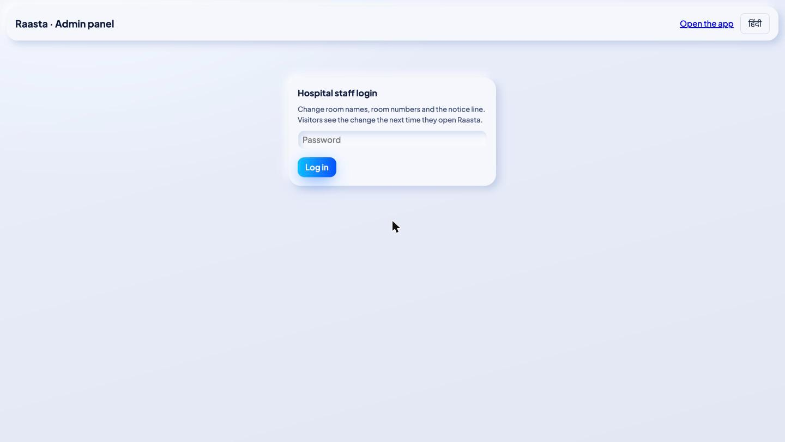
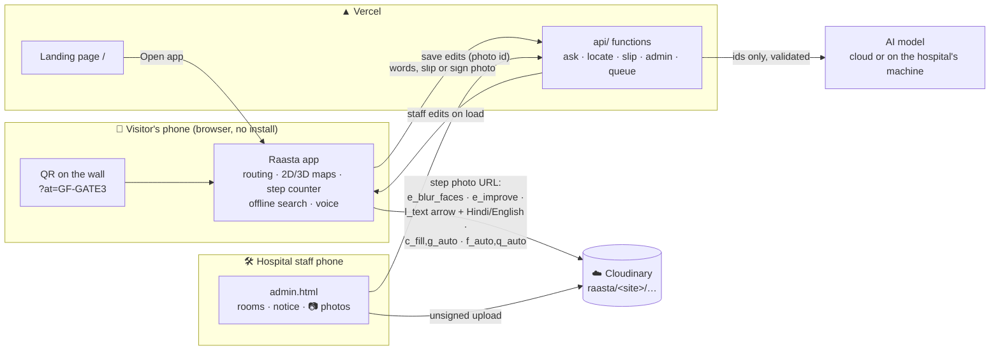
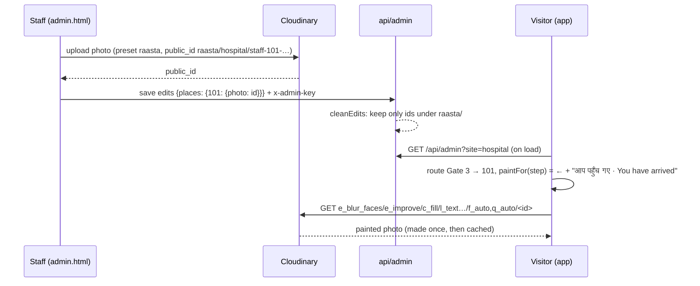

<div align="center">

# Raasta · रास्ता

### Hospital mein rasta, apni bhasha mein. Har mod ki asli photo ke saath.

**Indoor wayfinding for Indian hospitals.** Scan a QR on the wall, ask in Hindi, Hinglish or English, and follow a
step-by-step route across floors, with a **real photo of every turn that Cloudinary paints the arrow on**.
No app install. No beacons. No login.

[](https://raasta-shebuilds.vercel.app)
[](https://raasta-shebuilds.vercel.app/app/)
[](https://raasta-shebuilds.vercel.app/admin.html)


*Hacktober HackDays 2026 · SheBuilds Delhi × MLH · theme: **Empowering Local Communities** (healthcare, accessibility)*



</div>

---

## 🏆 How it meets the judging criteria

| Criterion | What we built |
|---|---|
| **Problem statement & solution (50%)** | Big government hospitals are mazes: ~200 rooms, 4 floors, signs in one language, visitors who are worried, elderly or do not read English. Raasta needs only a QR sticker and the phone the visitor already has: ask in your own words, get a route across floors, follow a **real photo of each turn**. Routing works with no internet. |
| **Cloudinary integration (30%)** | Cloudinary turns a plain staff photo into a **direction sign**: faces in the corridor blurred, light fixed, the step's arrow and a Hindi + English line painted on, cropped and compressed for 2G, all in one URL. Hospital staff add photos **from their phone in the admin panel**, uploaded straight to Cloudinary with no server of ours. [Details ↓](#️-what-cloudinary-does) |
| **Notion documentation (20%)** | Problem, decisions, architecture, every Cloudinary parameter and why, challenges and lessons: [`NOTION.md`](NOTION.md) (mirrored on our Notion page). |

## 🏥 The problem

A visitor from a village arrives at a 4-block, 4-floor government hospital with an OPD slip. They do not read
English well, and floor plans mean nothing to them. They ask three strangers where the blood bank is. Google Maps
stops at the gate, beacons and apps never get installed, and nothing shows what the next turn actually looks like.

## ☁️ What Cloudinary does

A visitor who cannot read a map **can** follow a photo. So every step shows a real photo of that spot, and Cloudinary
makes it a sign:


<sub>Left: what staff upload. Right: what the visitor sees, made by one Cloudinary URL. (Test photo from Cloudinary's sample set.)</sub>

| | What happens | Cloudinary |
|---|---|---|
| 🙈 | **Every face in the corridor is blurred** before any visitor sees the photo | `e_blur_faces:800` |
| 💡 | Dim hospital light fixed | `e_improve` |
| ⬅️ | **The arrow for this step** in a blue badge | `l_text:Arial_120_bold:←,b_rgb:2563eb,bo_22px…/fl_layer_apply,g_center` |
| 🗣️ | **The instruction in Hindi + English**: *बाएँ मुड़ें · Turn left*, *लिफ्ट से 2 · Lift to 2*, *आप पहुँच गए · You have arrived* | `l_text:Hind_40_bold:…,w_880,c_fit/fl_layer_apply,g_south` (Hind = Devanagari font) |
| 📱 | Cropped to the phone, keeping the subject | `c_fill,g_auto,w_960,h_540` |
| 📶 | Right format and quality per device: a few KB on 2G | `f_auto,q_auto` |
| 📷 | **Staff add a photo of any room from the admin panel**; it goes straight from their phone to Cloudinary | Upload API, unsigned preset `raasta`, `public_id = raasta/<site>/staff-<room>-<time>` |

One photo per spot serves any number of steps: the arrow and words differ per step, and Cloudinary makes and
caches each version. Without Cloudinary configured the app shows the plain photo, so nothing breaks offline.



<sub>The last step of a route from Gate 3 to the Blood Bank: the photo staff added, painted by Cloudinary, next to the Real 3D map.</sub>

Code: [`src/cld.ts`](src/cld.ts) (URLs + upload) · [`src/ui/scene.ts`](src/ui/scene.ts) `paintFor()` (arrow + words per step) ·
[`src/admin.ts`](src/admin.ts) (staff photo column) · [`src/data/edits.ts`](src/data/edits.ts) (only ids in our folder are accepted) ·
[`tools/cld-upload.mjs`](tools/cld-upload.mjs) (bulk upload) · [`tests/cld.test.ts`](tests/cld.test.ts).

## 📸 Screenshots

<table>
<tr>
<td width="50%"><br><sub><b>App.</b> You are at Gate 3; ask, or tap a place. Route on the Real 3D map.</sub></td>
<td width="50%"><br><sub><b>Step by step.</b> Real photo with the arrow painted on by Cloudinary; step counter; "problem on the way".</sub></td>
</tr>
<tr>
<td><br><sub><b>Landing page.</b> A live 3D model of the hospital and the features, including the Cloudinary ones.</sub></td>
<td><br><sub><b>Staff panel.</b> Password-protected: rename rooms, fix numbers, set the notice, add photos.</sub></td>
</tr>
</table>

## ✨ Features

**For the visitor**
- 🖼️ **A real photo of every turn**, arrow + Hindi/English line painted by Cloudinary, faces blurred (a first-person Real-3D render where no photo exists yet)
- 🗣️ **Ask in your own words**, typed or spoken: *"mausa ko blood chahiye"* → Blood Bank; *"papa ICU mein hain"* → ICU attendant waiting (AI)
- 📄 **OPD slip photo** → the right department · 📷 **photo of a room sign** → "you are here"
- 🧭 **Shortest route across floors** by lift or stairs; **step-free** route; **"lift not working"** re-route
- 👣 **Step counter** (phone motion sensor) moves the route as you walk and **warns you if you go the wrong way**
- 🚧 **Problems on the way**: "way blocked", "can't take stairs" → a new route from where you stand
- 🚶 **Crowd-aware**: usual busy hours + anonymous live walker count → two route options
- 🔊 **Read aloud** in Hindi or English · 🗺️ **2D, 3D and Real 3D** maps · 🌗 day / night themes
- 🔗 **QR deep links** (`?at=<spot>`), printable QR sheets · 📴 **offline** after the first visit

**For hospital staff** ([`/admin.html`](https://raasta-shebuilds.vercel.app/admin.html))
- Rename rooms, fix room numbers and search keywords, set the notice line, in English and Hindi
- **📷 Add a photo of any room from a phone**: it uploads to Cloudinary and the next visitor's route shows it, blurred and painted
- Password on the server (`ADMIN_PASSWORD`), compared in constant time; only changes from the original are stored

## 🧱 Architecture



**A staff photo, from upload to the visitor's step**



| Layer | What | Why |
|---|---|---|
| Frontend | Vite + TypeScript (no framework), Three.js | fast on budget phones; the 3D map is plain Three.js |
| Look | "Soft 3D" design system (`src/ui/soft.css`) | neumorphic day theme, navy-glass night theme, one set of tokens |
| Media | **Cloudinary** | every real photo: privacy blur, light fix, arrow + text, crop, format |
| AI | An open-weight language + vision model (cloud API, or on the hospital's own machine) | understands Hindi/Hinglish intent and reads slips/signs; returns ids we check |
| Server | Vercel functions in `api/` | AI, staff edits, live crowd count; routing never needs it |
| Data | `public/sites/<id>/site.json` + staff edits | buildings are data, not code |

## 🚀 Run it

```bash
git clone https://github.com/shaunmortal/raasta && cd raasta
npm install
cp .env.example .env     # set VITE_CLOUDINARY_CLOUD, VITE_CLOUDINARY_PRESET (unsigned), ADMIN_PASSWORD,
                         # and the AI key (see .env.example)
npm run dev              # landing /, app /app/, staff panel /admin.html, api /api/*
npm test                 # 106 Vitest tests
```

| `.env` | |
|---|---|
| `VITE_CLOUDINARY_CLOUD` | your Cloudinary cloud name (without it, plain local photos are shown) |
| `VITE_CLOUDINARY_PRESET` | an **unsigned** upload preset, default `raasta` |
| `ADMIN_PASSWORD` | staff panel password; the panel is off when empty |
| `GEMINI_API_KEY` | the AI model through a cloud API (for Vercel); `.env.example` shows how to run it locally instead |

## 🤖 How the AI is wired (`api/`)

- `POST /api/ask` → `{destination_id, start_id}`. Prompt = the building's place list + its `aiRules` + the
  visitor's words. The model returns **ids only**; every id is checked against the building data, and the spoken
  sentence (*"ब्लड बैंक पहली मंज़िल पर है।"*) is built from the data, so the model can never announce the wrong floor.
- `POST /api/locate` → `{node_id}` from a sign photo. `POST /api/slip` → place id from an OPD slip; the prompt
  forbids copying personal details and only a place id comes back.
- Timeouts, a per-IP rate limit, clear error codes; on any error the page falls back to the built-in search.

## 🎬 Demo script (2 minutes)

1. **Story.** "At a big hospital in Bhopal my family got lost looking for the blood bank."
2. **Scan.** Open the QR link: you are at Gate 3.
3. **Ask in Hinglish.** *"mausa ko blood chahiye"* → Blood Bank, 1st floor. **Start navigation**, **Read aloud** in Hindi.
4. **The photo.** Walk the steps: a real photo, faces blurred, the arrow and *आप पहुँच गए* painted on by Cloudinary.
5. **Staff add a photo, live.** Admin panel → 📷 on any room → take a photo → Save. Open that room's route: it is there, painted.
6. **Lift not working.** Tap it → the route switches to the stairs.

## 📁 Project layout

```
index.html, src/landing/  landing page (live 3D model, scroll story)
app/index.html            app shell
admin.html, src/admin.ts  staff panel (rooms, notice, photos)
src/cld.ts                Cloudinary: step-photo URLs, staff upload
src/ui/                   panels; scene.ts paints arrows per step; soft.css is the design system
src/engine/               graph, Dijkstra, steps, step text (en/hi), crowds, problems, pedometer
src/map2d/ map3d/         2.5D SVG map; Three.js 3D + Real 3D
src/data/                 site types, loader, validation, staff edits
api/                      ask, locate, slip, status, admin, feedback, queue
public/sites/hospital/    the demo hospital (generated by tools/gen_hospital.py)
tools/                    hospital generator, QR sheet, plan tracer, Cloudinary bulk upload
tests/                    Vitest (106 tests)
docs/shots/               the images in this README
```

## 🔒 Privacy

No accounts, no tracking, no analytics that identify people. Questions and slip photos go only to the AI model, only when
the visitor asks, and are not stored. Spot photos are only ever shown through Cloudinary with every face blurred.

## ⚖️ Honest limits

- "Demo City Hospital" is a made-up, AIIMS-sized building (4 blocks, 4 floors, ~190 rooms); not an official app of any hospital.
- Staff edits are kept in server memory on Vercel, so a cold start forgets them; a real deployment needs a small store (e.g. Vercel Blob).
- The unsigned upload preset means anyone who finds it can upload to our folder; a real hospital should sign uploads and moderate.
- Raasta started before this hackathon as our hospital-wayfinding prototype (routing, maps, AI search, step counting,
  admin panel). During Hacktober HackDays we built the Cloudinary photo layer, the staff photo upload, the new
  design system and the landing page integration.

## License

MIT
